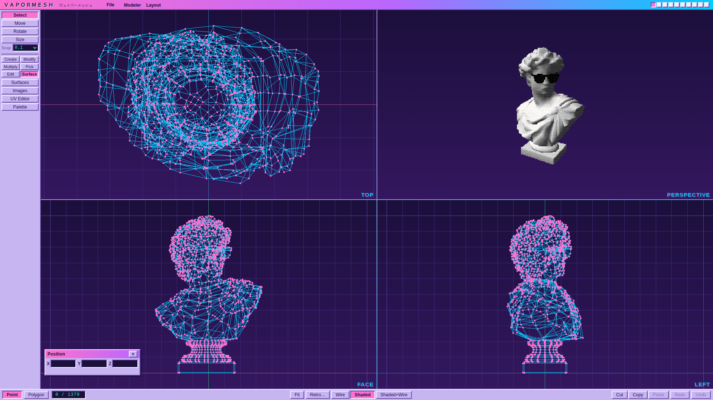

# VaporMesh

Authoring tools for making game assets and cutscene video with a mid-90s look, in the browser: low-poly meshes, flat and
Gouraud shading, a 256-colour palette, low-resolution dithered renders. The assets are meant for any engine (Unity, say); VaporMesh
is not an engine and has no runtime.

> Inspired by LightWave 3D. VaporMesh is an independent project and is not
> affiliated with or endorsed by NewTek or Vizrt.



## Status

The **Modeler** is the part that exists. The rest of the plan is in [`docs/SPEC.md`](docs/SPEC.md), with its order.

| Done | |
|------|---|
| Modeling | Box, ball, disc and cone; move, rotate, size, a numeric panel and a live position readout; extrude, bevel, array/clone, lathe, mirror; stretch, drag, magnet, bend, twist, taper; knife; boolean between layers; select connected, grow, shrink, lasso, grid snap; hide and show polygons and layers; delete, merge, weld, flip, make polygon, triple; cut, copy and paste; ten layers |
| Surfaces and textures | Per-surface name (renameable, undoable), colour (from the palette), diffuse, luminosity, specular, smoothing and angle; indexed images, PNG import, per-corner UVs, a UV editor with projections |
| Palette | One 256-colour palette per project, a palette editor, `.gpl` and `.act` import and export, palettes from pictures |
| Look | A retro Shaded view: low resolution, nearest-neighbour upscaling, ordered dither, mapped to the project palette |
| Projects | Save and load `.vmesh` files, with undo for everything ([format](docs/FORMAT.md)). Import and export Wavefront `.obj` (with a `.mtl` of colours) |

Not yet: smooth shift (the rest of Multiply), the texture painter, glTF export, Layout and cutscenes,
the animator, the tracker.

## The panels

The left panel keeps the tools you reach for constantly (**Select, Move, Rotate, Size** and the **Snap** menu) at the top, and
groups the rest in tabs, one at a time. Move, Rotate and Size act on what is selected; with nothing selected, dragging in a view draws a
selection box (and clicking picks) instead of transforming the whole object.

| Tab | |
|-----|---|
| Create | Box, Quad, Ball, Disc, Cone |
| Modify | Numeric, Position, Stats, and the deformers: Stretch, Drag, Magnet, Bend, Twist, Taper |
| Multiply | Extrude, Bevel, Array, Lathe, Mirror, Knife, Boolean |
| Pick | All, Invert, None, Connected, Grow, Shrink, Lasso |
| Show | Hide, Hide Others, Unhide All (polygons); Solo Layer, Show Layers |
| Edit | Delete, Merge Points, Weld, Flip, Make Polygon, Triple |
| Surface | Surfaces, Images, UV Editor, Palette |

To **lathe**, click the profile points in order along the outline (Point mode, bottom to top), choose Lathe, then drag in a
view to place the axis: the shape follows the pointer. The options set the axis direction, the sides and the angle.

**Hiding.** Hidden polygons are not drawn, picked or selected, and edits that act on "everything" skip them where they can; hiding is
display state, so it is not saved and any edit that renumbers polygons shows them again. Hidden **layers** are not drawn in any view.
Shift-click a layer square (top right) to hide or show it; only a background layer can be hidden, and going to a hidden layer shows it.
Which layers are hidden is saved in the project. OBJ export still writes every layer.

New, Load, Save, Import OBJ and Export OBJ are in the **File** menu in the menu bar (`Ctrl+O` and `Ctrl+S` still work).

**OBJ** keeps points shared, n-gons, UVs and one material per surface: its colour and shininess, smoothing (the OBJ's own `s` lines) and the rest of the surface settings (diffuse, luminosity, smoothing angle, double-sided, texture name), which go in a `# vapormesh` comment in the `.mtl` that other tools skip. Each layer is an object: exporting writes
`name.obj` and `name.mtl`; importing puts each object into an empty layer, and picks up colours from the `.mtl`: select both files together (Ctrl-click), or pick just the `.obj` and the app asks
for the `.mtl` it names, since a web page cannot open it by itself. Without it, surfaces come in uncoloured. Texture images are not written, since an OBJ can only point at an image file; glTF export, later, will carry them. From other tools, `s` groups become smooth surfaces and the `.mtl` colour is matched to your palette. Choosing a tool with its key shows its tab, and the last tab is remembered.

## Keys

**Hide hidden** (bottom bar) draws only the lines and points the model does not cover in each view, so the far side stops cluttering the wireframe. It is remembered. Box and lasso selection still reach points on the hidden side.

**Axis locks** (X, Y, Z buttons above Snap, or the `X` `Y` `Z` keys) limit Move, Rotate and Size to the axes you switch on; none on means free. Move keeps only those components, Size scales only along them, and Rotate turns about a single locked axis (swept around the pivot if the axis points out of the view, otherwise by dragging across it).

**Reference…** (Show tab) puts an image behind a Top, Face or Left view for tracing. It sits in the world, so it pans and zooms with the model; set its offset, width and opacity in the panel, or hide it. It is not saved with the project, so load it again next session.

**Stats** (Modify tab, `J`) shows the size of the selection, or of the whole layer when nothing is selected, with its point and polygon counts. Type a new X, Y or Z and it scales about its centre; *Keep proportions* scales the other axes with it. One undo step; flat axes cannot be scaled.

Each orthographic view has a side menu in its corner (Top, Bottom, Face, Back, Left, Right), so any of the three can look from the opposite side or from another axis; pan and zoom are kept. The choice is not saved with the project.


| Key | |
|-----|---|
| `Q` `M` `R` `S` | Select, Move, Rotate, Size |
| `E` `K` | Extrude, Knife (hold `Shift` while dragging the knife for a horizontal or vertical cut) |
| `1` `2` `P` | Point mode, Polygon mode, switch between them |
| `A` | Fit: centre every view on the whole model and zoom to show all of it (also the **Fit** button; done automatically after opening the startup model and importing an OBJ) |
| `N` `I` `U` | Numeric panel, Position panel, UV editor |
| `H` | Hide the selected polygons; with nothing selected, show what is hidden again. `Shift+H` hides everything but the selection (then `Space` clears the selection, so `H` shows them again) |
| `Space` | Clear the selection |
| `F` | Make a polygon (a face) from the selected points, in the order you picked them |
| `Delete` | Delete the selection |
| `Ctrl` + `A` `I` | Select all, invert the selection |
| `Ctrl` + `C` `X` `V` | Copy, cut, paste |
| `Ctrl` + `Z` `Y` | Undo, redo (`Ctrl+Shift+Z` also redoes) |
| `Ctrl` + `S` `O` | Save, open |

Moves, Drag, Magnet, Extrude and Size snap to the grid set by the **Snap** menu (0.01 by default, remembered between sessions; the menu goes from 0.005 up to 1, and Off drags freely). For a model about one unit tall, 0.01 is 1% of its height.
In a view, the middle or right button, or `Shift` with the left, pans; the wheel zooms; the left button orbits the Perspective view.

## Running it

```sh
npm install
npm run dev        # the editor, on http://localhost:5173
npm run typecheck  # tsc, including the tests
npm test           # unit tests (vitest)
npm run build      # typecheck + production build
```

The editor opens on the mascot, [`mascot.vmesh`](mascot.vmesh), a Greek bust with sunglasses. It is an ordinary project file: to change
what the editor opens on, replace it (it is read at build time and served with the app). Add `?blank` to the address to open on a
plain box instead. If the startup file cannot be loaded the box is shown, with the reason in the status bar.

It needs a browser with WebGL 2.

## Structure

| Path | Purpose |
|------|---------|
| `src/core` | The data model, with no rendering in it: meshes, surfaces, UVs, palettes, indexed images, colour conversion |
| `src/modeler` | Everything that edits a model: state, undo history, tools, geometry operations. Pure functions where possible, so they are testable |
| `src/render` | Three.js: the four viewports, the wireframe and shaded views, the retro post-process |
| `src/io` | The `.vmesh` project format |
| `src/ui` | The panels and dialogs, in the retro style |
| `src/layout` | Reserved for Layout (camera, lights, keyframes); empty for now |
| `docs/` | `SPEC.md` (what this is and the order it is built in) and `FORMAT.md` (the file format) |

`design/` holds reference screenshots and is deliberately not committed.

## Licence and credits

VaporMesh is [MIT](LICENSE). The only third-party code in the built app is [three.js](https://threejs.org) (MIT), whose notice
ships with the build as [`THIRD-PARTY-LICENSES.txt`](public/THIRD-PARTY-LICENSES.txt). Everything else installed is a build
or test tool (Vite, Vitest, TypeScript) and is not part of what you ship.

The code is original to this repository. It uses well-known published techniques, written from scratch:

- Booleans merge BSP trees (Naylor, Amanatides and Thibault, 1990), the same family as `csg.js`.
- Concave polygons are triangulated by ear clipping (Meisters, 1975).
- The retro look uses Bayer ordered dither (1973) and Gouraud shading (1971).
- The knife splits polygons against a plane in the usual way, then repairs T-junctions.

None of it comes from Blender (GPL) or from LightWave. The tool names are generic modelling terms.
